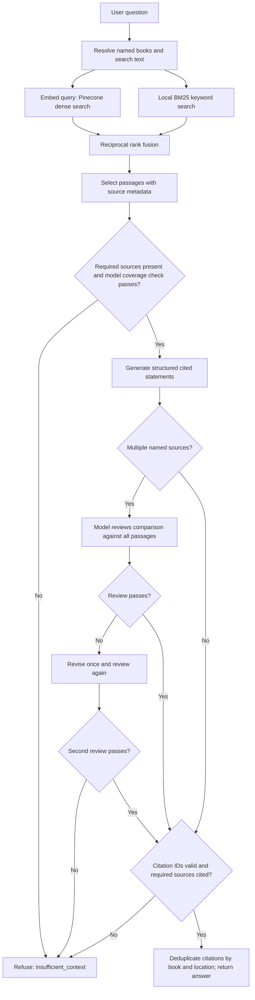

# Quantum Primer

An illustrated introduction and source-grounded knowledge assistant for curious beginners exploring quantum biology through their own books. Answers identify the source, author, and page/section. The Python service also provides a JSON API and an optional Streamlit interface.

**Status:** a local illustrated website with an integrated knowledge assistant and a Python RAG backend. The website uses the Hero's Journey design skill in `app-design/`, the three supplied reference images, and introductory reading trails across the six-book library. Live mode uses your local book manifest, Pinecone account and model keys. No books are bundled. No evidence-tier scoring is imposed.

## Launch the redesigned website

```powershell
Set-Location 'C:\Users\shyam\Documents\Claude\Projects\quantum-primer'
.\start-website.ps1
```

Open http://127.0.0.1:8501 and choose **Ask a question** or **Ask your guide**. Stop with Ctrl+C. The existing `.\start-chat.ps1` now launches this same website. If port 8501 is already occupied by the old Streamlit app, stop that process first.

The website serves HTML, CSS, JavaScript, images and fonts locally. A FastAPI route calls the existing Python service; no provider keys are sent to the browser. Only book titles, author names and source IDs are exposed by `/api/library`, never the private manifest or raw books. The public introduction works even if the model provider is unavailable; assistant failures offer a retry. Questions remain independent, and conversation history lasts only while the page is open.

This launcher binds to loopback for a local preview. The website's local chat route is separate from the existing authenticated API and is not configured for public hosting. The original Streamlit interface remains in `streamlit_app.py` and can be launched with the command below on a different port if needed.

Visual details: portrait-led scroll opening, continuous background, dark/light themes, illustrated reading sections, live library list, and a modal assistant with citations, refusal states and retry. Mobile layouts remove scroll motion and offsets; reduced-motion preferences are also respected. Image records and credits live in `web/imagery.js`; source images are copied unchanged from `app-design/references/`. Open Sans and IM Fell fonts and their licenses are served from `web/fonts/`.

Introduction references: *Life on the Edge*, chapters 3, 4 and 6; *Health and Light*, preface; *Optimize*, introduction and chapter 2; *The Mitochondriac Manifesto*, PDF pages 122–124; *Your Spark is Light*, PDF pages 35–38; *Epi-paleo Rx*, PDF page 135. Copy distinguishes the authors' accounts from established conclusions and links to the reading room. The artwork is illustrative, not scientific imagery.

## Vercel deployment

The private source repository is https://github.com/shyamsrini364/quantum-primer.
Live site: https://quantum-primer.vercel.app.
The Vercel project is `quantum-primer` under `shyamsrini26-7342s-projects`.
`app.py` exposes the same FastAPI service used locally. Vercel deployment and
production domains are accepted through Vercel's server-provided environment variables.

The live assistant requires the private `data/index.json` manifest as well as the
existing Pinecone namespace. The manifest is excluded from GitHub and included only
in the Python server bundle; there is no public file route for it. Raw books and
local `.env` files are excluded from deployment. Model and Pinecone credentials
are configured as sensitive Vercel environment variables, never frontend settings.

Automatic Git deployments are disabled because a Git checkout does not contain the
private library. After approval to host the indexed passages on Vercel, publish
updates from this workspace with:

```powershell
.\.venv\Scripts\python.exe scripts/prepare_vercel.py
vercel.cmd deploy --prod --yes --cwd reports/vercel-stage
```

For a fresh checkout, restore the private manifest locally, run the preparation
script, then link with `vercel.cmd link --yes --project quantum-primer --cwd reports/vercel-stage`.
The deployment directory is ignored by Git. Never commit it or the library manifest.
Changing the indexed library requires preparing and deploying a new server bundle.

## Original Streamlit interface (optional)

Run these exact commands in PowerShell:

```powershell
Set-Location 'C:\Users\shyam\Documents\Claude\Projects\quantum-primer'
.\.venv\Scripts\python.exe -m pip install -e '.[ui,dev]'
.\.venv\Scripts\python.exe -m streamlit run streamlit_app.py --server.address 127.0.0.1 --server.port 8503 --server.headless true --browser.gatherUsageStats false
```

Open http://127.0.0.1:8503 for the original Streamlit interface. Stop the server with Ctrl+C. Virtual environment activation is unnecessary. The UI calls the existing Python service directly, so no separate API server is needed. It shows chat history, loading feedback, expandable source citations and safe error messages. Questions are independent; history is for display, not model memory.

For the original Streamlit interface, rerun its command above from this project in a normal PowerShell terminal. For the redesigned website, use `.\start-website.ps1`; its launcher sets the working directory so `.env` and the manifest resolve correctly. If the UI reports that it cannot connect to Pinecone, check internet/firewall access. A server started inside a coding agent's restricted sandbox may serve the UI but cannot reach Pinecone; stop it and launch from your terminal. The UI's **Retry connection** button retries startup after a transient connection failure.

The existing `.env` stays on the server. Live settings use `QP_MODE=live`, embedding model `Qwen/Qwen3-Embedding-8B`, chat model `Qwen/Qwen3-30B-A3B-Instruct-2507`, and base URL `https://api.tokenfactory.nebius.com/v1/`. Keep the configured keys private. The existing `data/index.json` and Pinecone snapshot are reused; **do not re-ingest to launch the UI**. Restart the server after configuration or manifest changes. This interface is intended for local use and binds to loopback.

Displayed citations are deduplicated by source ID and page/section, with inline numbers remapped in order of first use. All retrieved chunks remain available to the model.

For questions about a particular book, name its main title, for example "In Optimize, how does Catherine Clinton describe exclusion zone water?" Search then scopes both Pinecone and BM25 to that book. General questions search the entire library. Single-word titles should be introduced with "In" or placed in quotation marks to distinguish them from ordinary words.

For comparisons, name both books, for example: `Compare “Optimize” and “The Mitochondriac Manifesto”: how does each author describe EZ water? Cite both books.` Straight or curly quotation marks work. Each named book gets its own dense and keyword ranking; passages are selected in rotation, giving two passages per book with the default four-context limit. The context limit expands to at least one passage per named book if necessary. The app refuses a comparison when a named book has no retrieved evidence or is absent from the generated citations. The model is instructed to cite both sides of similarities and differences and avoid inferring agreement from missing evidence. A separate model call checks comparisons against all supplied passages; a failed review allows one revision, then refuses if the revision fails review. This adds latency and model usage to comparisons. These checks enforce source coverage and improve grounding, but model review does not guarantee semantic faithfulness; inspect the cited passages when assessing a comparison. Run `python -m quantum_primer.cli evaluate evals/comparisons.json` for the focused live check.

Try “How does the author describe DHA?” and “How do I configure Kubernetes ingress for a multiplayer Minecraft server?” The latter should return insufficient context.

Verification commands (the final command uses live providers and API credits):

```powershell
.\.venv\Scripts\python.exe -m pytest -q
.\.venv\Scripts\python.exe -m ruff check .
.\.venv\Scripts\python.exe -m quantum_primer.cli evaluate evals/local-smoke.json --output reports/local-smoke.json
```

UI tests use Streamlit's AppTest with mocked providers; install the `ui` extra to run them. The live report records expected-status matches and cited-source recall; it does not establish scientific accuracy or citation faithfulness.

## Run the demo

Python 3.11+ (tested on 3.12). From this directory:

```bash
python -m venv .venv
# macOS/Linux:
source .venv/bin/activate
# Windows PowerShell instead:
# .venv\Scripts\Activate.ps1
python -m pip install -e ".[dev]"
quantum-primer ask "What is Quantum Primer?"
uvicorn quantum_primer.api:app --reload --host 127.0.0.1
```

Open http://127.0.0.1:8000/docs for the interactive API. Demo uses a deterministic fixture and extracts its answer; it does not run embeddings, Pinecone or a live LLM. Scientific questions intentionally return insufficient context in demo mode.

## Connect your books and providers

1. Copy `.env.example` to `.env`. Set `QP_MODE=live`, `QP_MODEL_API_KEY`, exact chat and embedding model IDs from your provider dashboard, `QP_PINECONE_API_KEY`, and a strong random `QP_API_KEY`. Nebius's OpenAI-compatible endpoint is configured; change the base URL if your account uses a different endpoint. Keys stay server-side.
2. Put books under `data/raw/` and create `data/catalog.json` using the schema below. These paths and local index snapshots are ignored by Git. Paths in a catalog are relative to that catalog.
3. Preview ingestion, then index:

```bash
quantum-primer ingest data/catalog.json --dry-run
quantum-primer ingest data/catalog.json
quantum-primer ask "How does the author describe mitochondria?"
uvicorn quantum_primer.api:app --host 127.0.0.1
```

```json
{
  "sources": [
    {
      "id": "my-book-01",
      "path": "raw/my-book.pdf",
      "title": "Exact book title",
      "author": "Exact author name",
      "source_type": "book",
      "topics": ["light", "mitochondria"]
    }
  ]
}
```

Use stable unique source IDs. Supported formats: text PDFs, EPUB, Markdown and UTF-8 text. PDF references are physical PDF page numbers (may differ from printed numbers). EPUB references use spine sections. Markdown uses headings. Scanned PDFs need OCR first. Cleaning fixes line-break hyphenation and repeated spaces; it does not yet detect repeating headers, footers, diagrams, tables or multi-column reading order. Inspect your extracts before relying on them.

Chunks are section/page-bounded, up to 650 cl100k_base tokens with 80-token overlap. This is a starting setting, not model-specific optimization: ensure your embedding model supports this length. LangChain supplies splitting and model interfaces; LangGraph supplies orchestration.

### Adding more books or PDFs

1. Copy new PDFs or EPUBs into `data/raw/`. Scanned PDFs need OCR before ingestion.
2. Append one entry per book to the `sources` array in `data/catalog.json`, using the schema above. Give each a unique, stable `id`, its actual title and author, and a path such as `raw/second-book.pdf`.
3. **Keep all existing entries.** Ingestion builds the entire active library from this catalog; a catalog containing only the new book would remove earlier books from active retrieval.
4. Run the commands below from the project directory. The dry run checks extraction without API calls. The ingestion command embeds the complete catalog, including existing books, and incurs provider usage.

```powershell
.\.venv\Scripts\python.exe -m quantum_primer.cli ingest data/catalog.json --dry-run
.\.venv\Scripts\python.exe -m quantum_primer.cli ingest data/catalog.json
```

After successful ingestion, allow Pinecone time to make the new vectors searchable, then stop the chat server with Ctrl+C and restart with `.\start-chat.ps1`. Test a question specific to each new book and inspect its citations. No model or index change is needed to add books. The previous manifest remains active if ingestion fails before the final manifest replacement. Old Pinecone namespaces remain available for manual cleanup; ingestion is a full snapshot rebuild, not an incremental upload.

### Snapshot details

The CLI probes the embedding dimension and creates a **Pinecone vector index using SDK 7.x**, with cosine distance. A newly provisioned index may require rerunning ingestion after it becomes ready. An existing index must match dimension and metric. Ingestion sends book text to the embedding provider; Pinecone receives vectors and source IDs. The local manifest keeps private chunk text for generation and keyword search. Generation sends selected passages to the model provider.

The complete catalog produces an immutable namespace keyed by the content and embedding configuration. Re-ingesting identical content overwrites identical IDs; changed content selects a new namespace. The local manifest switches only after successful writes, so removed sources do not remain in active retrieval. Old namespaces are retained and may incur storage costs; manually delete inactive ones in Pinecone when no longer needed. Wait for Pinecone's eventual consistency before querying a newly ingested snapshot. Run one ingestion process at a time and restart the API after ingesting; it loads the manifest at startup.

Changing embedding model or provider requires re-ingestion, even with identical dimensions. Use a fresh index if dimensions differ. Never mix indexes or manifests across deployments. Back up the catalog and local manifest securely.

## Retrieval and answering

The guide aims to teach rather than recite: lead with a plain-language idea, explain relevant terms, use a source-backed example or clearly labelled analogy when helpful, and optionally suggest a practical learning tip. Attribution appears naturally without repeating an author's name or credentials in every paragraph. Authors' hypotheses and health recommendations remain attributed; learning tips are not personal treatment, supplement or sun-exposure instructions. Answers stay on the user's topic and do not append comparison conclusions to single-book questions. These behaviors are configured in `src/quantum_primer/graph.py`; they are prompt changes, not a trained model fine-tune. `evals/tutoring.json` contains live teaching-style checks for review.



See [Architecture — Week 2 project review](docs/architecture.md) for ingestion, storage, ranking settings, verification limits and links to the implementation.

Dense top-8 and lexical top-8 are fused and reduced to 4 contexts. Lexical queries deduplicate terms and omit common function words and presentation words such as "explain", "example" and "plain language", so teaching instructions do not crowd out subject matches. Dense search and answer generation retain the question wording after the existing retrieval-only book/author scoping. The dense threshold (default 0.35) is tunable and is not a probability; BM25 can still contribute exact matches below it. No neural reranker is included. A model judges whether the retrieved material covers the question. Empty retrieval, failed coverage, malformed JSON or unknown citation IDs cause a refusal. Provider outages produce an HTTP 503, not a fabricated answer.

Each generated statement must carry at least one valid source ID. This validates citation provenance, **not whether a claim is actually supported**. Review faithfulness manually using the evaluation workflow. Model-based grading and prompt-injection resistance are not guarantees. The source-attribution prompt avoids turning an author's claims into unqualified facts and keeps personal medical decisions outside this educational prototype.

## API contract

- `GET /health`: process readiness and `demo`/`live` mode; does not probe upstream availability.
- `GET /sample-questions`: grouped chips, specific to the active mode.
- `POST /chat`: `{"question": "What does the author mean by EZ water?"}`.
- Live mode requires `X-API-Key`; demo can optionally require it via `QP_API_KEY`.

```json
{
  "answer": "The author describes ... [1]",
  "status": "answered",
  "mode": "live",
  "citations": [
    {"id": "1", "source_id": "my-book-01", "title": "Book title", "author": "Author", "locator": "PDF page 12"}
  ]
}
```

No raw source excerpts are returned by the citations endpoint fields. Answers themselves may still paraphrase or reproduce source wording. This is a private prototype; ownership of a book does not automatically grant public redistribution rights. Review rights before deploying publicly.

The API is single-question, stateless and non-streaming. For a frontend, put a server-side proxy between the browser and this backend so `QP_API_KEY` never goes in browser code. See `docs/frontend-handoff.md`. No public deployment, user accounts, quotas, distributed keyword index or conversation memory are included. Add these before opening it to other users.

## Tests and evaluation

```bash
pytest -q
ruff check .
quantum-primer ingest examples/catalog.json --dry-run
quantum-primer evaluate evals/demo.json
# After adding your books, label expected source IDs/statuses in evals/questions.json:
quantum-primer evaluate evals/questions.json --output reports/live-evaluation.json
```

The 15 live evaluation prompts are a template; expected sources must be labelled after inspecting your corpus. Reports measure latency, refusal agreement and cited-source recall where labelled. Citation presence is not a faithfulness score. Fill the human review fields and failure notes before claiming the proposed 90% faithfulness target. Proposed latency target: p95 under 15 seconds; unmeasured until live evaluation.

`requirements-tested.txt` records the dependency versions installed during scaffold verification, for reproducibility on Python 3.12. Install those before `pip install -e . --no-deps` to reproduce that environment. The regular pyproject ranges allow updates; rerun tests before upgrading.

## Project files

- `src/quantum_primer/`: loaders, models, provider adapters, retrieval, LangGraph, API, CLI.
- `tests/`: offline functional and contract checks; no API credits needed.
- `examples/`: original ingestion fixture and catalog example.
- `evals/`: demonstration cases and 15 live evaluation prompts.
- `docs/`: scope decisions, frontend handoff, submission outline and iteration log.

Next: review the live smoke report and tune retrieval on your 15 questions. The Google Doc and demo video remain separate submission tasks.
