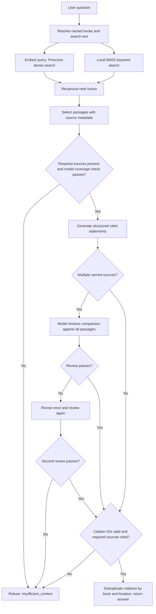
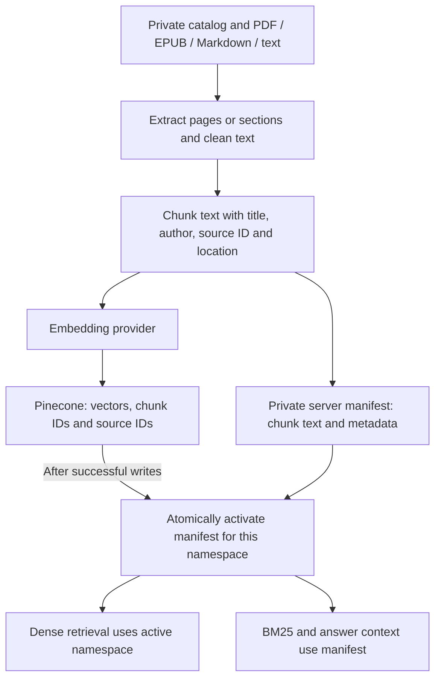

# Quantum Primer architecture — Week 2 project review

This describes the implementation on `main` reviewed on 24 October 2026. It expands the retrieval and verification flow requested in the Week 2 feedback.

## Retrieval and verification

The LangGraph nodes are **retrieve → grade → generate**, with a **refuse** branch after grading. The comparison review, one permitted revision, citation validation and citation formatting run inside the generate node; they are expanded above to make their behavior visible.

1. **Scope the question.** Recognized book titles constrain retrieval. Each named book receives an independent dense and lexical ranking so one book cannot crowd out another.
2. **Retrieve in two ways.** The query embedding searches the active Pinecone namespace. Local BM25 searches the private manifest's chunk text, with repeated terms and common instruction words removed from its query.
3. **Fuse rankings.** Each ranking contributes `1 / (60 + rank)`. Defaults are top 8 dense results (filtered by minimum score 0.35), top 8 positive BM25 results, and 4 selected contexts. Named books are selected in rotation; the limit expands to at least one passage per named book. This is hybrid retrieval with reciprocal rank fusion, not LLM-generated multi-query RAG-Fusion or a neural reranker.
4. **Check coverage before answering.** Required named sources must be present and a model must judge the passages sufficient for the whole question. Empty or insufficient evidence produces a refusal.
5. **Generate and verify.** The model returns structured statements with citation IDs. For multiple resolved named sources, a second model call reviews the draft against all passages. A failed review permits one revision and one further review; a second failure refuses.
6. **Validate and display.** Unknown citation IDs or missing required cited sources cause refusal. Schema validation requires cited statements. Display citations are deduplicated by source ID and page/section, with inline numbers remapped in order of first use.

Malformed structured responses also cause refusal. Provider failures are handled separately from insufficient evidence; they must not be interpreted as an evidence-based refusal.

## Ingestion and storage

Chunks are page/section bounded, with defaults of 650 tokens and 80-token overlap. A snapshot namespace is derived from content and embedding configuration. The manifest switches only after successful vector writes. Raw books and the manifest are excluded from Git; an independent checkout can use the original demo fixture without access to the private corpus.

In live mode, book text is sent to the embedding provider during ingestion. Selected passages are sent to the chat model for grading, generation and comparison review. Pinecone receives vectors and source IDs rather than the raw passages. Credentials remain on the server.

## What the checks establish

Citation validation checks that citations refer to retrieved passages and that required books are represented. It does **not** prove that every claim is supported or scientifically correct. The extra comparison review is model-based and can make mistakes. Human review of the cited passages remains necessary. Demo mode uses deterministic fixtures and does not exercise live embeddings, Pinecone or a live language model.

## Code map

| Component | Implementation |
| --- | --- |
| Extraction, cleaning and chunking | [ingest.py](../src/quantum_primer/ingest.py) |
| Embeddings, Pinecone snapshot and manifest activation | [providers.py](../src/quantum_primer/providers.py) |
| Book scoping, dense/BM25 retrieval and fusion | [retrieval.py](../src/quantum_primer/retrieval.py) |
| Graph routing, coverage, generation, review and citations | [graph.py](../src/quantum_primer/graph.py) |
| Structured answer and citation schemas | [models.py](../src/quantum_primer/models.py) |
| Evaluation workflow | [validation.md](validation.md) |

The website, optional Streamlit interface, CLI and JSON API use the Python backend. This diagram focuses on the shared retrieval and verification pipeline rather than deployment-specific UI routes.
