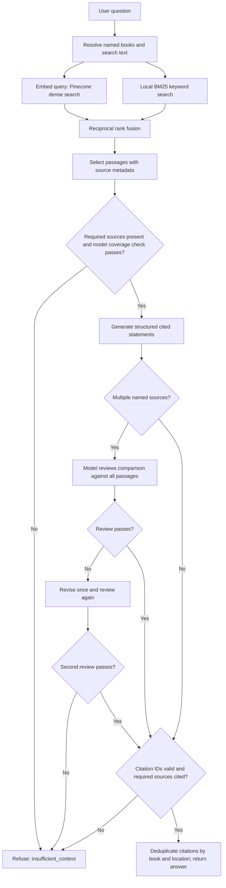

# Week 2 submission working outline

Handout: https://docs.google.com/document/d/1J86kVvwlSb8EJH8mOpZE6t4XSXzS58y0ukMvmbtmkn8/

## Overview
Quantum Primer introduces curious beginners to quantum biology through answers grounded in a personal book collection. It uses the code-heavy LangChain/LangGraph track, Pinecone and an OpenAI-compatible model provider (Nebius by default).

## Datasets
TODO: list actual book titles, authors, editions, formats, page counts and source IDs. No books were supplied during the initial implementation. The included demo guide is an original software fixture only.

## Architecture and prompts
See [Architecture — Week 2 project review](architecture.md) for the full retrieval and verification flow, ingestion/storage diagram and code map. The core flow is included below.

Use the framework in `project-scope.md`. Generation and source-coverage prompts are in `src/quantum_primer/graph.py`. Coding prompt and implementation decisions are in `iteration-log.md`.

## Iterations and findings
The initial build implements hybrid retrieval, source validation and refusal behavior. Add real examples of retrieval failure, chunking changes, prompt changes and their measured effects after running the book corpus. Do not describe offline tests as evidence of real-world answer faithfulness.

## Evaluation
Run the 15 cases in `evals/questions.json` after labelling expected sources. Report refusal accuracy, cited-source recall, response latency, and human-reviewed faithfulness/relevance. Explain errors and changes; target >=90% faithfulness, not yet measured.

## Five-minute demo outline
- 0:00–0:40: motivation and intended beginner user.
- 0:40–1:20: selected corpus, source metadata and ingestion.
- 1:20–2:40: two live questions with citations and source inspection.
- 2:40–3:20: an out-of-corpus refusal.
- 3:20–4:20: LangGraph flow, retrieval and how AI coding tools helped.
- 4:20–5:00: evaluation results, limitations and next improvements.

## Still to submit
- Google Doc containing overview, corpus, coding prompts, iterations and learnings.
- Video no longer than five minutes demonstrating the live final result.
- GitHub project URL (create/push a remote once a destination is selected).

Deadline in the handout: Sunday 18 October 2026, 11:59pm Pacific. At that date PDT is UTC-7 and Sydney is UTC+11, so this is Monday 19 October at 5:59pm Sydney. The handout says late work still counts for certification but not Builder of the Week.
